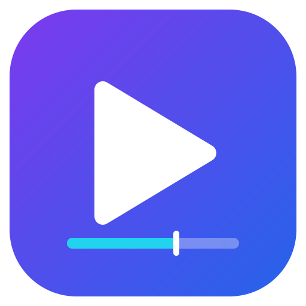
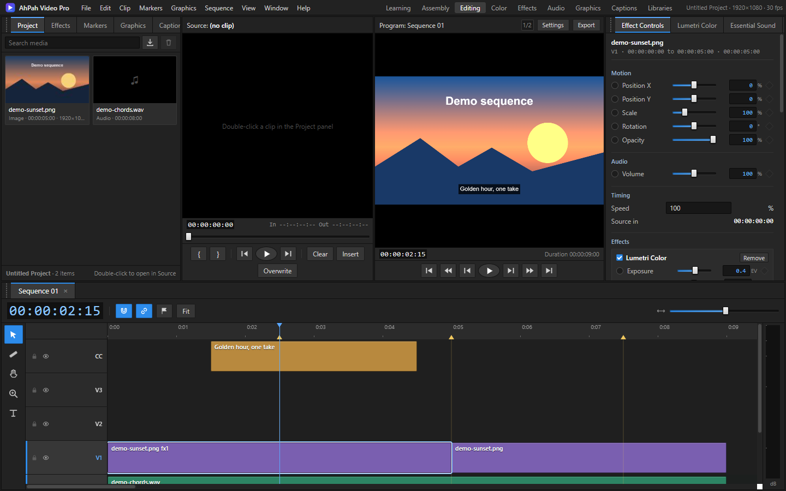
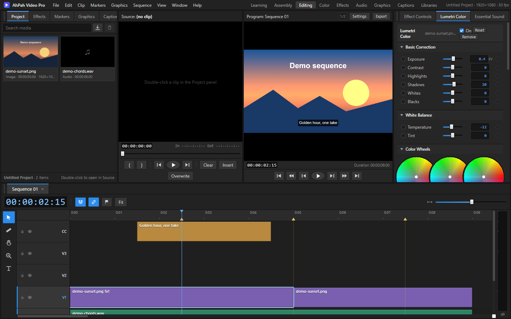
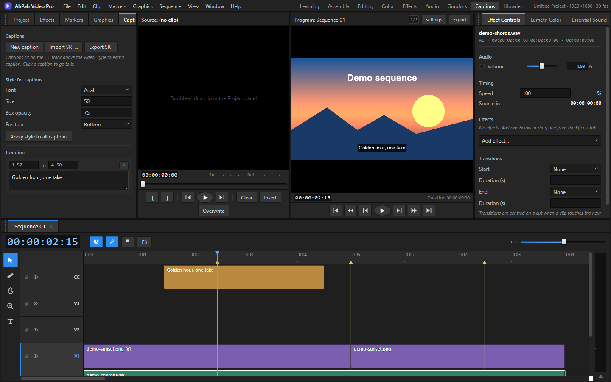
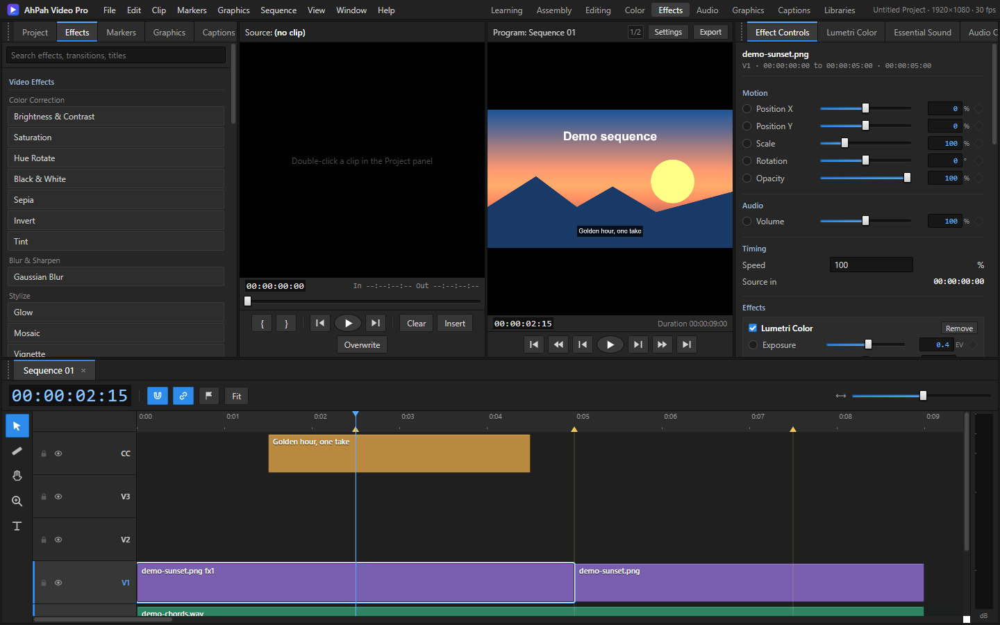
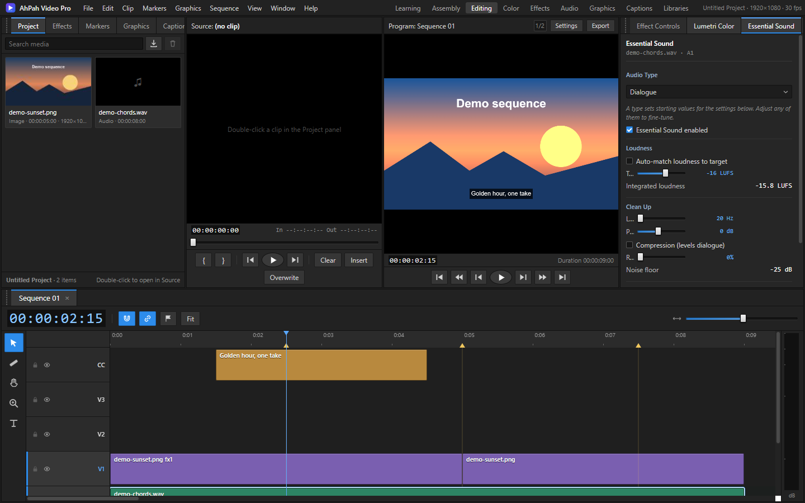
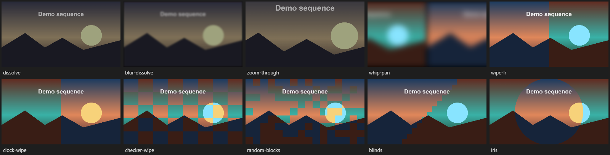
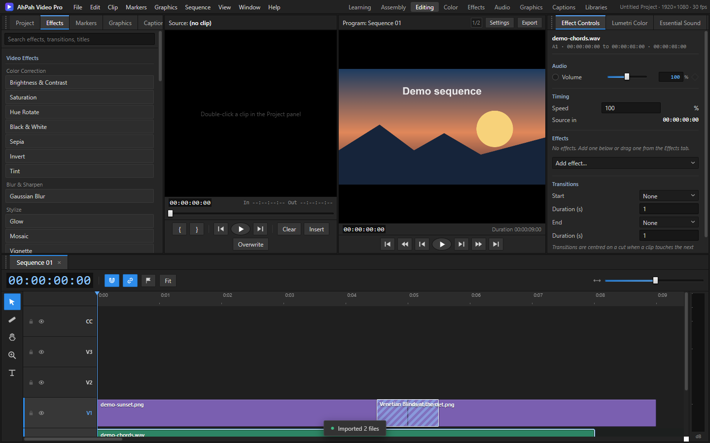

# AhPah Video Pro

<p align="center">
  
</p>

**AhPah Video Pro** is a free, open-source video editor that runs in your web browser. It
follows the Premiere Pro Editing layout: a menu bar and workspace tabs, a Project panel with
Effects and Markers tabs, Source and Program monitors, Effect Controls and Metadata tabs,
and a multi-track timeline with a tool palette and master meters. It has effects, transitions, titles,
keyframes and export to WebM or MP4, with no installer and no server.

**Use it now in your browser: https://ahpah-dev.github.io/ahpah-video-pro/**

You can also download the files and open `index.html` from your own computer.

It is released into the **public domain under the [Unlicense](LICENSE)**. Use it, change
it, sell it or bundle it however you like.

> AhPah Video Pro is an independent project. It is not affiliated with, endorsed by, or
> connected to Adobe Inc. "Premiere Pro" is a trademark of Adobe; it is mentioned only to
> describe the layout.

## Screenshots

The editing workspace, with the Program monitor, Effect Controls and timeline:



Lumetri Color with basic correction and colour wheels:



Captions workspace, with caption text and timing on the CC track above the video:



Effects workspace with the effects library:



Essential Sound on an audio clip:



All the video transitions, each at its midpoint:



Dragging a transition onto a cut shows where it will land:



## Features

- **Import** video, audio and still images. Imported clips keep their full original length
  (images use 5 seconds by default). Waveforms are drawn on audio and video clips.
- **Timeline**
  - Video and image clips show their frames: a filmstrip of the source, moved with the clip's in point and scaled with the zoom.
  - Three video and three audio tracks, with add / delete track, show / hide, mute and lock.
  - Move clips (including between tracks of the same type) and trim from either edge.
  - Dropped and trimmed clips overwrite what is beneath them.
  - Razor tool, ripple delete, copy / paste, duplicate, link / unlink and enable / disable.
  - Snapping to the playhead, clip edges and markers.
  - Markers (M), a work area (`[` and `]`) and rubber-band selection.
  - Markers on a clip: right-click a clip and hover **Cut at Markers** to split at every marker inside it, put any transition at each marker (dissolve, dip, wipe and more), keep only the part between the first and last marker, or remove the markers. The same actions are in the Clip menu.
  - Undo and redo.
- **Source monitor**: mark In and Out, then Insert (`,`) or Overwrite (`.`) at the playhead.
  Clips with sound place linked video and audio clips.
- **Effects** (Effect Controls or the Effects tab; drag onto a clip, or click an item to apply it to the selection):
  brightness and contrast, saturation, hue rotate, black and white, sepia, invert, blur,
  glow, mosaic, vignette, film grain, crop, flip, tint, drop shadow, light leak, lens flare,
  scan lines and letterbox.
- **Motion**: position, scale, rotation and opacity, with keyframes (the stopwatch and
  diamond buttons). Each keyed control has a lane under it: click a keyframe to go to it, drag to move it. Keyframes also work on effect settings and volume.
- **Transitions** (17 video, plus constant-gain audio fades): cross dissolve, blur dissolve, dip to black
  and white, wipes (left to right, right to left, top to bottom, diagonal, box from the centre, iris,
  clock, checkerboard, random blocks and venetian blinds), slides (left, right, top, bottom), zoom,
  zoom through, whip pan and spin. Video transitions crossfade the linked audio.
- **Drag and drop transitions**: drag one from the Effects tab onto the timeline. Drop it on a cut
  between two clips and it is centred on the cut; drop it near a clip's start or end and it goes there.
  A dashed box shows the span it will cover before you let go, and turns red when the transition does
  not fit the track (a video transition over an audio clip). Clip menu: Transition at Start / End.
- **Titles**: title clips with a font picker that lists the fonts installed on this computer,
  and an "Add font" button for a .ttf, .otf or .woff file (saved with the project). Size, colour, bold / italic, outline, shadow,
  background box, alignment, line height and width. Six presets are included.
- **Speed**: change a clip's speed from 10% to 1600% (Ctrl+R).
- **Playback**: play, pause, reverse, frame stepping and jumps to edit points, at a
  choice of preview resolution (full, half or quarter). Drawing is paced to the display.
- **Export**: WebM (VP9 or VP8 with Opus) or MP4 where the browser supports it. Choose
  the frame size, quality and range (whole sequence or work area). Export a single frame
  as PNG.
- **Sequence settings**: frame size (HD, 4K, vertical, square) and frame rate.
- **Workspaces**: Editing, Assembly, Effects, Color, Audio, Graphics and Captions layouts (the other workspace tabs are placeholders).
- **Captions**: caption clips on the CC track above the video, edited in the Captions panel (text, start and end, style). Import and export SRT subtitle files. Captions are typed or imported; speech is not transcribed automatically.
- **Panel tabs**: drag a tab to reorder it or to move it to the other panel group. Window > Reset Panel Layout restores the default.
- **Typed values**: type into the box beside a slider (Effect Controls and Lumetri) and press Enter.
- **Moving panels**: drag the Source or Program header, or the grip (dots) on the Project, Effect Controls or timeline header. In the top row, drop a panel on the outer third of another to place it beside it, or in the middle to swap. Drop the timeline on the top or bottom edge of the window. Window > Reset Panel Layout and Reset Monitor Positions restore the defaults.
- **Panel sizes**: drag the gaps between the panels to resize them, and drag the gap above the timeline
  to make the timeline taller. Each workspace remembers its sizes. Tab strips scroll by wheel or drag.
  The timeline pans with the middle mouse button or the hand tool, in any direction.
- **Lumetri Color**: exposure, contrast, highlights, shadows, whites, blacks, white balance,
  three colour wheels (shadows, midtones, highlights), an RGB curves editor with per-channel
  curves, an HSL secondary, saturation, vibrance, faded film, sharpening and 3D LUTs (.cube).
  Computed on the GPU; the basic controls are keyframeable.
- **Essential Sound**: audio types, loudness auto-match to a target in LUFS (ITU-R BS.1770
  K-weighting with gating), low cut, presence, compression, noise reduction (a gate that closes
  between speech, using the clip's measured noise floor), reverb, and ducking of music and sound
  effects under dialogue.
- **Audio Clip Mixer**: track faders in dB, pan, a reverb send, mute, solo, meters, and
  automation of volume, pan and send with keyframes. A master meter sits at the timeline's edge.
- **Graphics (Essential Graphics)**: text titles, rectangles and ellipses with fill, stroke,
  size and corner radius, and a browser of title and lower-third presets.
- **Design**: a flat dark theme close to Premiere Pro, with strong custom sliders, checkboxes, selects and buttons, LCD-style timecode, collapsible Lumetri sections, and vertical mixer faders.
- **Context menus** on every area: clips, tracks, the ruler, markers, the Project panel,
  both monitors and the background.
- **Projects** (`.ahpvp`): save and reopen timelines. The timeline and every imported file are kept in
  the browser, so Recover after a reload brings back the clips, markers and media. A project opened on
  another computer needs its files imported again.

## Getting started

No build step and no dependencies are needed.

1. Download or clone this repository.
2. Open `index.html` in a recent version of Chrome, Edge or Firefox.
3. Press **Ctrl+I** and import some media, then drag a clip onto a track.

You can also serve the folder with any static server, for example `python -m http.server`
in the project folder, then visit `http://localhost:8000`.

### Supported formats

Which formats play depends on your browser. MP4 (H.264 / AAC), WebM (VP8 / VP9 with
Opus or Vorbis), MP3, WAV, OGG, PNG, JPEG, GIF and WebP work in current Chrome and Edge.
MOV and MKV files open only where the browser can decode them.

## Keyboard shortcuts

| Keys | Action |
| --- | --- |
| Space | Play / pause |
| J / K / L | Reverse / stop / forward |
| Left / Right | Previous / next frame (Shift: 1 second) |
| Up / Down | Previous / next edit point or marker |
| Home / End | Go to start / end |
| I / O | Mark In / Out in the Source monitor |
| `,` / `.` | Insert / overwrite the Source range at the playhead |
| V / C / H | Selection / Razor / Hand tool |
| S | Toggle snapping |
| M | Add marker at playhead |
| `[` / `]` | Work area In / Out at playhead |
| Ctrl+K | Cut selected clips (or every track) at the playhead |
| Ctrl+C / Ctrl+V / Ctrl+D | Copy / paste at playhead / duplicate |
| Ctrl+Shift+D | Apply the default transition to selected clips |
| Ctrl+R | Speed / duration of selected clips |
| Ctrl+T | New title at the playhead |
| Delete / Shift+Delete | Delete / ripple delete |
| Ctrl+Z / Ctrl+Shift+Z | Undo / redo |
| Ctrl+A / Ctrl+Shift+A | Select all / deselect all |
| = / - / \\ | Zoom timeline in / out / to fit |
| Ctrl+I / Ctrl+O / Ctrl+S / Ctrl+N | Import / open / save project / new project |
| Ctrl+M | Export video |
| Ctrl+Shift+E | Export frame as PNG |
| Esc | Stop an export, close a menu or dialog |
| ? | Show the shortcut list |

## Limitations

This is an early, browser-based editor. Known limits:

- Export runs in real time: a 10-minute sequence takes about 10 minutes. Keep the tab
  visible while it runs.
- Lumetri uses its own display-space maths. It is close to Lumetri in use, but it is not
  Adobe's implementation, and it has no Vignette-in-Lumetri or Look presets.
- Essential Sound loudness is measured per clip with BS.1770 K-weighting. Noise reduction is a
  gate, not spectral denoising, and the reverb is a synthetic room, not a sampled hall.
- Ducking follows the timeline, so the music lowers while a dialogue clip plays.
- Speed ramps and chroma key are not included.
- A 3D LUT is saved inside the project file, so large LUTs make large project files.
- Only three video and three audio tracks are created by default (more can be added).
- The preview is drawn at the chosen resolution; export always uses the chosen export size.
- Some effects (glow, mosaic, vignette, grain) and CSS-filter effects depend on the browser's
  canvas support. Safari may skip the colour and blur effects.
- Projects reference media by file name, so keep the originals in place.
- Some MP4 files have no decodable audio track. Those clips cannot be loudness-matched.

## Development

```text
index.html           Application shell (panels, toolbar, dialogs)
css/style.css        Dark editing theme
js/state.js          Shared state, undo history, data version, helpers
js/effects.js        Effect / transition / font definitions and timing maths (pure)
js/layout.js         Panel splitters and per-workspace sizes
js/edits.js          Split, trim, carve, insert, overwrite, speed, transitions, copy / paste
js/render.js         Frame compositor (direct draw, layers for post effects, cached index)
js/monitor.js        Program monitor: playback engine, preview size, WebM / MP4 export
js/bin.js            Project panel, import, duration detection, waveforms, Source monitor
js/menu.js           Context menus and drop-down menus
js/dialog.js         Forms and info dialogs
js/panels.js         Effect Controls and the Effects library
js/timeline.js       Timeline rendering and mouse editing
js/project.js        Project files and autosave
js/main.js           Actions, menu bar, keyboard shortcuts, startup
tests/edits-test.js  Unit tests for the editing, effect and transition rules
tests/effects-test.js  Unit tests for the new effects, transitions and fonts
assets/logo.svg      Application logo
```

Run the unit tests with Node 18 or later:

```bash
npm test
```

The modules are plain browser scripts that share a global `AVP` namespace, so they are easy
to read and change without tooling.

## Contributing

Issues and pull requests are welcome. Because the project is released into the public
domain, please only contribute code you have the right to dedicate under the Unlicense.

## License

This project is dedicated to the public domain under the Unlicense. See [LICENSE](LICENSE)
or <https://unlicense.org>.
